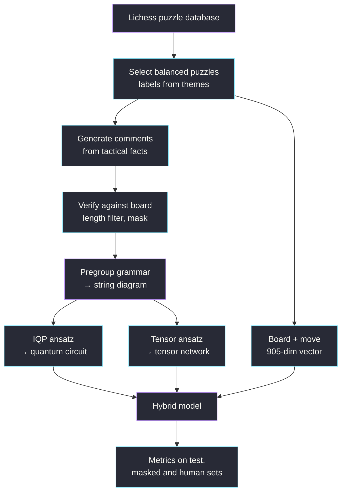

<div align="center">

# ♞ Chess QNLP

### Grammar-aware quantum circuits for recognising tactics in chess comments.

[](#%EF%B8%8F-roadmap)
[](#%EF%B8%8F-tech-stack)
[](https://github.com/CQCL/lambeq)

*Does the grammar of a sentence, encoded as a quantum circuit, tell a model anything about the tactic that the board and simple word counts don't?*

[Overview](#-overview) · [Features](#-features) · [Installation](#-installation) · [Usage](#-usage) · [Results](#-results)

</div>

---

## Table of Contents

- [Overview](#-overview)
- [Features](#-features)
- [Architecture](#%EF%B8%8F-architecture)
- [Mathematical Foundation](#-mathematical-foundation)
- [Tech Stack](#%EF%B8%8F-tech-stack)
- [Installation](#-installation)
- [Usage](#-usage)
- [Results](#-results)
- [Project Structure](#-project-structure)
- [Known Limitations](#%EF%B8%8F-known-limitations)
- [Roadmap](#%EF%B8%8F-roadmap)
- [Contributing](#-contributing)
- [License](#-license)

---

## 🧠 Overview

> [!NOTE]
> **The central idea:** each chess puzzle has a position, a key move, and one or more tactics (fork, pin, skewer, …). A short English comment describes the key move. The comment is parsed into a DisCoCat string diagram and compiled into a parameterised quantum circuit, the position becomes a 905-number vector, and a hybrid model predicts the tactics. The model is then compared fairly against classical baselines.

**Research question:** does a grammar-aware quantum encoding of a comment carry information about the tactic beyond what the board alone and a bag-of-words model provide?

| Hypothesis | Test |
|---|---|
| **H1** text helps | board + text (Q2, B6) vs board only (B2) |
| **H2** grammar helps | classical tensor network on the diagrams (B4) vs bag of words (B3), especially on the masked test |
| **H3** quantum is competitive | quantum circuit (Q1) vs its classical tensor-network twin (B4) |
| **H4** it isn't keyword spotting | every model is also scored with the motif words replaced |

### Motivation

- **Problem:** the earlier version of this project labelled comments with keyword rules and trained on the same text, so a high score could come from spotting the word "fork". Its comments also often contradicted the board.
- **Approach:** labels come from the board (Lichess theme tags), every comment is checked against the position with `python-chess`, and a keyword-masked test set measures how much each model relies on the motif word.
- **Outcome:** an honest comparison of quantum, grammar-aware and classical text models on the same splits. A negative result is an acceptable answer.

## ✨ Features

- **Labels from the board.** Targets are Lichess puzzle themes, never derived from the comment.
- **Verified comments.** Comments are generated from tactical facts computed with `python-chess`. A verifier rejects any comment whose pieces, colours or squares don't match the board (it also runs on any human-written comments you add).
- **Keyword-masked test set.** Every test comment has a copy with motif words replaced by neutral ones ("forks" → "attacks", "pins" → "holds").
- **Leak-free splits.** Rows sharing a puzzle or an identical sentence stay in the same split, stratified across motifs. Split IDs are committed.
- **Own pregroup grammar.** A small hand-written grammar parses the comments into DisCoCat diagrams (see [Known Limitations](#%EF%B8%8F-known-limitations) for why Bobcat isn't used).
- **One model, every ablation.** The same hybrid class gives text-only, board-only and combined models, with quantum or classical text branches.
- **Nothing silent.** Dropped comments and their reasons go to `dropped.csv`; parse failures, qubit counts and label counts go to `summary.json`; every run writes `metrics.json`.
- **Memory guard.** Circuits wider than `quantum.max_sim_qubits` are refused before simulation.

## 🏗️ Architecture



### Workflow

1. **Select puzzles:** stream the Lichess CSV, keep popular, well-played puzzles with a target motif, and sample about 500 per motif.
2. **Resolve the key move:** play the opponent's first move; the solver's reply is the key move.
3. **Generate and check comments:** describe the key move with a named or unnamed template, verify it, and drop it if it has the wrong length or fails to parse.
4. **Split:** group by puzzle and sentence, stratify by motif, and save the ID files.
5. **Train and evaluate:** baselines, tensor-network and quantum models over several seeds, plus ablations.

## ∑ Mathematical Foundation

**Pregroup grammar.** Each word has a type built from $n$ (noun) and $s$ (sentence) and their adjoints, which cancel:

$$x \cdot x^r \to 1, \qquad x^l \cdot x \to 1$$

A transitive verb has type $n^r \cdot s \cdot n^l$, so "rook pins knight" reduces to a sentence:

$$n \cdot (n^r \cdot s \cdot n^l) \cdot n \;\to\; s$$

Each cancellation becomes a cup in the string diagram, and the diagram becomes a circuit where each word is a block of rotations with trainable angles $\theta$. With $k$ sentence qubits, measurement gives $2^k$ probabilities.

**Loss.** Tactics overlap, so this is multi-label classification with one sigmoid per motif and weighted binary cross-entropy:

$$\mathcal{L} = -\frac{1}{NM}\sum_{i=1}^{N}\sum_{m=1}^{M}\Big[w_m\,y_{im}\log\sigma(z_{im}) + (1-y_{im})\log\big(1-\sigma(z_{im})\big)\Big]$$

Where:

- $N$ is the number of examples and $M = 6$ the number of motifs.
- $y_{im} \in \{0,1\}$ is the label and $z_{im}$ the model's score.
- $w_m$ = negatives ÷ positives for motif $m$ in the training set.

**Metric.** Macro-F1, the mean of the per-motif F1 scores, with per-motif thresholds tuned on validation.

## ⚙️ Tech Stack

| Component | Technology | Purpose |
|:--|:--|:--|
| Language | Python 3.11+ (tested on 3.14) | Core implementation |
| Chess | python-chess | Board logic, move facts, verification |
| QNLP | lambeq 0.5.0 | String diagrams, ansätze, rewriting |
| Quantum simulation | PennyLane | Differentiable circuit simulation |
| Learning | PyTorch, scikit-learn | Hybrid model, baselines, metrics |
| Splitting | iterative-stratification | Multi-label stratified splits |
| Testing | pytest | Unit tests |

## 🚀 Installation

### Prerequisites

- Git
- Python 3.11 or newer
- ~16 GB RAM is comfortable; the default configuration peaks around 1 GB

### Clone the repository

```bash
git clone https://github.com/ShreyasD21/Capstone_Project.git
cd Capstone_Project
```

### Set up the environment

```bash
python -m venv .venv
```

Activate it:

**Linux / macOS**

```bash
source .venv/bin/activate
```

**Windows PowerShell**

```powershell
.venv\Scripts\Activate.ps1
```

Install dependencies (the CPU build of PyTorch avoids a multi-gigabyte CUDA download):

```bash
pip install --index-url https://download.pytorch.org/whl/cpu torch
pip install -e ".[dev]"
```

### Get the data

```bash
bash scripts/download_data.sh    # Lichess puzzle database (CC0), ~300 MB
```

## 💻 Usage

```bash
# 1. Build the dataset (about a minute)
python -m chess_qnlp.prepare --config configs/default.yaml

# 2. Classical baselines (minutes)
python -m chess_qnlp.experiments --config configs/default.yaml --only baselines

# 3. Tensor-network and quantum models (hours: ~30 s per quantum epoch, 3 seeds)
python -m chess_qnlp.experiments --config configs/default.yaml --only neural

# 4. Quantum ablations from configs/ablations/
python -m chess_qnlp.experiments --config configs/default.yaml --only ablations

# 5. Rebuild the results table
python -m chess_qnlp.evaluate --summarise results/

# Tests
pytest
```

To check the whole pipeline in about a minute, use `configs/smoke.yaml` instead. Its results are meaningless.

### Adding human-written comments

`prepare` writes `data/processed/test_puzzles.csv`. Write comments for some of those puzzles into `data/human/comments.csv` with columns `puzzle_id,comment`, then run `prepare` again. They are verified and parsed like generated comments and scored as a separate "human" test set. With the project grammar, comments must stay within its vocabulary (`src/chess_qnlp/text/grammar.py`); unknown words are reported in `dropped.csv`.

### Models

| Name | Text | Board | Answers |
|---|---|---|---|
| B0_prior | — | — | The floor |
| B1_keyword | motif word present? | — | How far keyword spotting goes |
| B2_board | — | MLP | What the position alone explains |
| B3_bow | TF-IDF + logistic regression | — | Cheap text baseline |
| B4_tensor_text | tensor network on the diagram | — | Does grammar help? |
| B5_board_bow | TF-IDF | MLP | Strong classical combined baseline |
| B6_tensor_board | tensor network | ✓ | Classical twin of Q2 |
| Q1_quantum_text | IQP circuit | — | Is the quantum model competitive? |
| Q2_quantum_board | IQP circuit | ✓ | Does text add to the board? |

Ablations of Q1: 1 or 3 sentence qubits, 2 ansatz layers.

## 📊 Results

> [!IMPORTANT]
> Macro-F1, mean ± standard deviation over 3 seeds (`results/summary.md`, regenerated by step 5 above). Don't claim a difference when the ranges overlap. The "Free-written" column is the 60-comment `human` split; those comments were written by an AI assistant, not a person (see `data/human/README.md`).

| Model | Params | Test | Masked | Free-written |
|---|---|---|---|---|
| B0_prior | | 0.348 ± 0.000 | 0.348 ± 0.000 | 0.369 ± 0.000 |
| B1_keyword | | 0.471 ± 0.000 | 0.000 ± 0.000 | 0.176 ± 0.000 |
| B2_board | | 0.419 ± 0.005 | 0.419 ± 0.005 | 0.429 ± 0.005 |
| B3_bow | | **0.729 ± 0.000** | **0.600 ± 0.000** | 0.399 ± 0.000 |
| B4_tensor_text | 3,608 | 0.668 ± 0.038 | 0.492 ± 0.077 | 0.283 ± 0.037 |
| B5_board_bow | | 0.608 ± 0.007 | 0.527 ± 0.004 | 0.409 ± 0.012 |
| B6_tensor_board | 128,024 | 0.507 ± 0.029 | 0.463 ± 0.025 | 0.417 ± 0.022 |
| Q1_quantum_text | 3,068 | 0.690 ± 0.013 | 0.481 ± 0.066 | 0.266 ± 0.058 |
| Q2_quantum_board | 127,484 | 0.527 ± 0.020 | 0.495 ± 0.027 | 0.398 ± 0.015 |
| Q1 [1 sentence qubit] | 2,961 | 0.586 ± 0.039 | 0.448 ± 0.074 | 0.336 ± 0.021 |
| Q1 [3 sentence qubits] | 3,239 | 0.709 ± 0.015 | 0.543 ± 0.009 | 0.305 ± 0.039 |
| Q1 [2 layers] | 3,185 | 0.703 ± 0.009 | 0.527 ± 0.012 | 0.296 ± 0.015 |

| Hypothesis | Verdict |
|---|---|
| **H1** text helps | Partly. Text adds to the board on the test set (B2 0.419 → Q2 0.527, B6 0.507), but not on free-written comments. |
| **H2** grammar helps | No. The tensor network (B4) is below bag of words (B3) on every set, including masked. |
| **H3** quantum is competitive | Yes. Q1 and its tensor-network twin B4 overlap on every set. |
| **H4** not keyword spotting | Mostly not supported. Every text model drops on the masked set, and further on free-written comments, so they rely heavily on template wording. |

Dataset built by `configs/default.yaml` (seed 42):

| Stage | Count |
|---|---|
| Puzzles selected | 2,592 |
| Comments after verification | 2,592 |
| After the 3–12 word filter | 2,508 |
| After parsing and the 12-qubit budget | 2,508 |
| Train / val / test | 1,741 / 434 / 333 |

Circuits use 4–12 qubits (median 6); the vocabulary has 118 words, and 43% of comments name their motif.

## 📁 Project Structure

```text
Capstone_Project/
├── README.md
├── pyproject.toml
├── configs/
│   ├── default.yaml            # full experiment settings
│   ├── smoke.yaml              # tiny end-to-end check
│   └── ablations/              # one quantum setting changed per file
├── data/
│   ├── raw/                    # Lichess CSV (downloaded, not committed)
│   ├── processed/              # examples.csv, dropped.csv, summary.json
│   ├── cache/                  # parsed diagrams
│   ├── splits/                 # train/val/test ID files (committed)
│   └── human/                  # optional human-written test comments
├── scripts/
│   ├── download_data.sh
│   ├── prepare_data.py
│   └── run_experiments.py
├── src/chess_qnlp/
│   ├── constants.py            # MOTIFS: the one label order
│   ├── config.py
│   ├── data/                   # puzzles, labels, facts, comments, verify, masking, split
│   ├── board/encode.py         # 905-dim board + move vector
│   ├── text/                   # grammar, parsing, circuits
│   ├── models/                 # baselines, hybrid model
│   ├── prepare.py              # dataset pipeline
│   ├── train.py                # training loop
│   ├── experiments.py          # comparison table and ablations
│   └── evaluate.py             # metrics and summary
├── tests/
└── results/                    # one folder per run + summary.md
```

## ⚠️ Known Limitations

- **Bobcat can't be downloaded.** lambeq downloads its Bobcat parser from `qnlp.cambridgequantum.com`, which no longer exists (lambeq's latest source still points there). The project uses its own pregroup grammar instead, which is exact for the generated comments but only covers their vocabulary. If you have a Bobcat model folder (e.g. a copy of `~/.cache/lambeq/bobcat/bobcat` from an older install), set `text.parser: bobcat` and `text.bobcat_dir` in the config. The pipeline never falls back from one parser to another.
- **No Sim14 ablation.** With cups removed, lambeq 0.5 keeps negated parameters on flipped word boxes and PennyLane conversion fails (`KeyError: -1.0 word__type_0`); with cups kept, circuits reach ~22 qubits, and simulating them exhausted 16 GB of RAM in testing. Only the IQP ansatz is used.
- **Wide circuits are refused.** `quantum.max_sim_qubits` (15) stops any run whose circuits would need more memory than a laptop has. Two noun qubits (up to 18 qubits) needed over 6 GB even on the smoke set, so that ablation is not included.
- **Generated text.** Comments come from templates over verified facts, so the language is repetitive. Template wording correlates with the motif even when the motif word is masked ("both", "behind it"). A human-written test set is the remedy.
- **Simulation only.** No quantum hardware is used, and no quantum advantage is claimed.
- **Puzzles always contain a tactic.** The model never sees positions without one.

## 🗺️ Roadmap

- [x] Package structure, configs and tests
- [x] Puzzle selection, board-derived labels, verified comments, masked test
- [x] Grouped, stratified splits
- [x] Pregroup grammar, IQP circuits, tensor-network twin
- [x] Baselines, hybrid model, training loop, ablations
- [x] Run the full experiments and fill in the results
- [x] Free-written (AI-written, non-template) test comments
- [ ] Human-written test comments
- [ ] Write-up

## 🤝 Contributing

1. Create a branch for your change.
2. Run `pytest` before committing.
3. Change settings through `configs/`, not code, so every result can be traced to a config.
4. Open a pull request describing the change.

## 📜 License

No license has been chosen yet. Until one is added, the default copyright rules apply. The Lichess puzzle database is CC0.

---

<div align="center">

*Built with curiosity, rigor, and a willingness to experiment.*

**[⬆ Back to top](#-chess-qnlp)**

</div>
